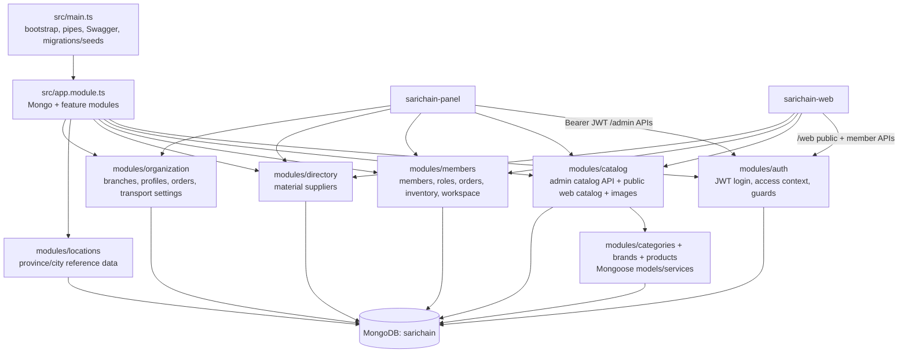

# Sarichain Backend — Knowledge Graph

> Snapshot: `main` | Architecture map for future task handoffs. Verify DTOs, guards and service logic before changing contracts.

## Runtime and stack
- NestJS 11 + TypeScript + Mongoose 9 + MongoDB; Swagger at `/docs`.
- Node.js >= 22. Build: `npm run build`; dev: `npm run start:dev`.
- Database: `sarichain`; environment validation is centralized in `src/config/environment.ts`.
- Global validation transforms inputs, whitelists DTO fields and rejects unknown properties.
- Startup performs marketplace migration, admin bootstrap, optional demo seeding and location import.

## Knowledge graph

## Domain modules and responsibilities
- **auth**: login by username/phone, JWT, `GET /auth/me`, access-token and admin guards, role/access context.
- **catalog**: authenticated admin catalog CRUD and tags; public `/web/products`, categories, brands; catalog image handling and producer-offer enrichment.
- **categories / brands / products**: Mongoose schemas and base catalog domain models.
- **members**: member records and roles, account upgrades, marketplace profile, web orders/cart/weekly basket/workspace, transport and inventory workflows.
- **directory**: material-supplier directory; published listing for authenticated readers, management CRUD for administrators.
- **locations**: province/city datasets and query endpoints.
- **organization**: branch/profile configuration, branch-scoped orders, transport orders and tariffs.

## Important data/contract relationships
- Catalog collections: `products`, `categories`, `brands`, shared `tags`. Categories are hierarchical; product variants refer to a master product; offers are producer-owned and are distinct from catalog product records.
- Members: panel users are distinct from marketplace member profiles; customer/producer/service roles may coexist on a shared member account. Phone uniqueness/migration logic is centralized in members services.
- Public catalog prices are derived from current producer offers, not simply the product's base catalog price.
- Web orders are persisted separately from catalog and use current server-side offer/pricing validation.
- Directory material suppliers are not producer offers and do not represent an order/quote workflow.
- Organization access scope is separate from a member's marketplace capabilities.

## API consumers
- `sarichain-panel`: `/auth`, `/catalog`, `/members`, `/directory`, `/locations`, `/organization`, inventory and transport endpoints.
- `sarichain-web`: public `/web/products`, `/web/categories`, `/web/brands`; authenticated `/web/login`, profile, orders, delivery, workspace, transport and location endpoints.

## Change-impact guide
- Cross-cutting startup/config: `src/main.ts`, `src/app.module.ts`, `src/config/`.
- Authentication/authorization: `src/modules/auth/` plus access checks in the target service.
- Request contract: matching `*.dto.ts`; persistence: `*.schema.ts`; business rules: `*.service.ts`; HTTP surface: `*.controller.ts`.
- Public storefront contract changes should be coordinated with `sarichain-web`; admin contract changes with `sarichain-panel`.
- Do not assume a route is writable merely because it is visible in Swagger; inspect guards and service-level access scope.

## Cross-project links
- Admin panel: https://github.com/lllidon/sarichain-panel
- Public website: https://github.com/lllidon/sarichain-web
