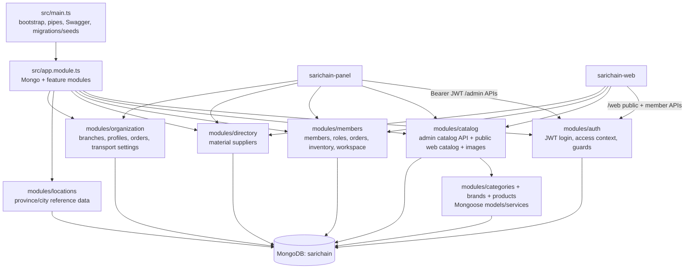

# Sarichain Backend — Knowledge Graph

> Snapshot: `main` | Architecture map for future task handoffs. Verify DTOs, guards and service logic before changing contracts.

## Runtime and stack
- NestJS 11 + TypeScript + Mongoose 9 + MongoDB; Swagger at `/docs`.
- Node.js >= 22. Build: `npm run build`; dev: `npm run start:dev`.
- Database: `sarichain`; environment validation is centralized in `src/config/environment.ts`.
- Global validation transforms inputs, whitelists DTO fields and rejects unknown properties.
- Startup performs marketplace migration, admin bootstrap, optional demo seeding and location import.

## Knowledge graph

## Domain modules and responsibilities
- **auth**: login by username/phone, JWT, `GET /auth/me`, access-token and admin guards, role/access context.
- **catalog**: authenticated admin catalog CRUD and tags; public `/web/products`, categories, brands; catalog image handling and producer-offer enrichment.
- **categories / brands / products**: Mongoose schemas and base catalog domain models.
- **members**: member records and roles, account upgrades, marketplace profile, web orders/cart/weekly basket/workspace, transport and inventory workflows.
- **directory**: material-supplier directory; published listing for authenticated readers, management CRUD for administrators.
- **locations**: province/city datasets and query endpoints.
- **organization**: branch/profile configuration, branch-scoped orders, transport orders and tariffs.

## Important data/contract relationships
- Catalog collections: `products`, `categories`, `brands`, shared `tags`. Categories are hierarchical; product variants refer to a master product; offers are producer-owned and are distinct from catalog product records.
- Members: panel users are distinct from marketplace member profiles; customer/producer/service roles may coexist on a shared member account. Phone uniqueness/migration logic is centralized in members services.
- Public catalog prices are derived from current producer offers, not simply the product's base catalog price.
- Web orders are persisted separately from catalog and use current server-side offer/pricing validation.
- Directory material suppliers are not producer offers and do not represent an order/quote workflow.
- Organization access scope is separate from a member's marketplace capabilities.

## Producer category scope and seller-offer authorization

- Marketplace producer permissions are stored on the member as `allowedProductCategoryIds: string[]` in `src/modules/members/member.schemas.ts`. The member profile exposes this field to the website.
- `POST /web/account-upgrades/producer-categories` in `src/modules/members/account-upgrades.controller.ts` is for an already-approved producer only. It validates the requested category IDs against the `categories` collection, rejects unchanged/empty/oversized selections, snapshots current and requested IDs and labels, and creates a pending `producer_categories` request. A unique partial index prevents more than one pending request of this kind per member.
- The existing management review endpoint `PATCH /members/account-upgrades/:id/review` handles this request kind. On approval it replaces `allowedProductCategoryIds` with the requested set, provided the member is still an approved producer. Category-scope changes do not award the one-time onboarding Karsha credit; rejection leaves the current permissions unchanged.
- Seller offer creation in `src/modules/members/web-workspace.controller.ts` checks that the member is an approved producer and that the selected product's `categoryId` is included in `allowedProductCategoryIds`. The MongoDB product projection must include `categoryId`; omitting it makes the authorization comparison fail even for a correctly authorized producer. This regression was fixed on `main` by adding `categoryId: 1` to the projection (backend PR #7).
- Related website flow: `sarichain-web/docs/KNOWLEDGE_GRAPH.md`. Related review UI: `sarichain-panel/docs/KNOWLEDGE_GRAPH.md`.
- Deployment note: the backend route and authorization fix are source changes on `main`; the running API must be rebuilt/restarted before the fix is effective in production.

## Seller fulfillment build compatibility

- `src/modules/members/seller-fulfillment.service.ts` builds a unique buyer/member ID list from order rows before loading buyer profiles.
- The intermediate collection is a JavaScript `Set<string>`; it must be converted to an array before calling array methods such as `filter` and `map`. Current implementation uses `Array.from(new Set(...))`, then explicitly types the string callback parameters and converts valid values to `Types.ObjectId`.
- This fixes the deployment TypeScript errors TS2339 (`filter` does not exist on `Set<string>`) and TS7006 (implicit `any` for `id`). Merged to `main` in backend PR #8.
- When local builds pass but deployment fails on this line, compare the deployed checkout/commit with `origin/main`; the source being built may differ from the current local tree or may be stale. Confirm the deployed commit contains the `Array.from(new Set(...))` expression.

## Local catalog image storage

- `src/scripts/download-catalog-images.ts` downloads demo catalog product and category images, converts them to optimized WebP, and writes them under `public/uploads/products/` and `public/uploads/category/`.
- MongoDB image fields must store relative paths only, e.g. `/uploads/products/SC-1001.webp` and `/uploads/category/demo-fresh-produce.webp`; do not persist a host/domain or environment-specific absolute URL.
- `src/main.ts` serves the uploads directory at the `/uploads/` URL prefix. The frontend resolves the relative path against its configured backend base URL (currently `https://admin.dehaat.ir`).
- Run with `npm run catalog:download-images`. The command builds the backend and runs the downloader. Re-running refreshes the local files and demo catalog image paths.

## API consumers
- `sarichain-panel`: `/auth`, `/catalog`, `/members`, `/directory`, `/locations`, `/organization`, inventory and transport endpoints.
- `sarichain-web`: public `/web/products`, `/web/categories`, `/web/brands`; authenticated `/web/login`, profile, orders, delivery, workspace, transport and location endpoints.

## Change-impact guide
- Cross-cutting startup/config: `src/main.ts`, `src/app.module.ts`, `src/config/`.
- Authentication/authorization: `src/modules/auth/` plus access checks in the target service.
- Request contract: matching `*.dto.ts`; persistence: `*.schema.ts`; business rules: `*.service.ts`; HTTP surface: `*.controller.ts`.
- Public storefront contract changes should be coordinated with `sarichain-web`; admin contract changes with `sarichain-panel`.
- Do not assume a route is writable merely because it is visible in Swagger; inspect guards and service-level access scope.

## Cross-project links
- Admin panel: https://github.com/lllidon/sarichain-panel
- Public website: https://github.com/lllidon/sarichain-web
